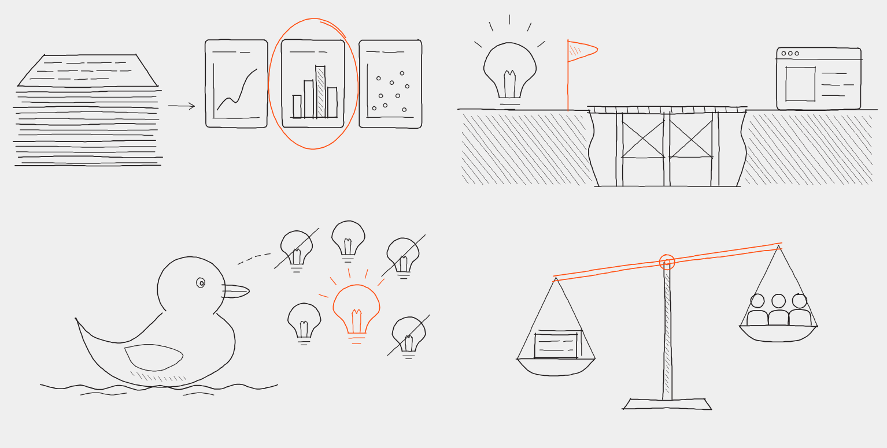

# article-drawings

An agent skill that reads an article and **draws illustrations for it** as fine pen line art: black ink,
one accent colour, a little hatching, no fills. Each drawing draws itself stroke by stroke on a `<canvas>`
when it scrolls into view.

No image model and no source photo. Every stroke is placed by code, so the drawings are small, sharp at any
size, and easy to change.



## What it does

1. **Reads the whole article** and picks one meaning for the accent colour, taken from the article's argument.
   In the drawings above, orange is always the call a person makes.
2. **Picks the scenes**, about one per 300 words. Each one illustrates a specific sentence, starting with the
   writer's own images.
3. **Draws them** with a small kit of pen helpers: lines that wobble and overshoot, hatching, handwriting
   dashes, sheets of paper.
4. **Checks them by eye** on a rendered preview and fixes what's wrong.
5. **Places them** in your page, with captions from the article's own words.

## Install

**Claude Code**
```bash
git clone https://github.com/huttenthomas/article-drawings ~/.claude/skills/article-drawings
```
It needs Node 18 or later. The preview uses Google Chrome. On anything other than macOS, or with Chrome
somewhere else, set `CHROME` to its path.

**Claude apps (claude.ai / desktop)**: zip this folder and upload it under *Settings → Capabilities → Skills*.

Then ask something like:
> Illustrate my post in `content/blog/why-roadmaps-lie.md`.

> Draw two images for this article, in a fine pen style with my brand colour as the accent.

## What's in here

| File | What it is |
|---|---|
| `SKILL.md` | The method the agent follows |
| `scripts/pen-kit.mjs` | The pen helpers, with no dependencies |
| `scripts/build.mjs` | Builds figure files into one stroke file |
| `scripts/preview.mjs` | Renders figures to a PNG and warns about strokes off the canvas |
| `scripts/player.js` | The canvas player, framework-free, 5 KB |
| `examples/` | The source of the drawings above, plus `kitchen.mjs`: a reference for drawing a person |

To try it without an agent:
```bash
node scripts/build.mjs examples /tmp/drawings.js
node scripts/preview.mjs /tmp/drawings.js /tmp/preview.png
```

These are simple, deliberately sketchy drawings, not detailed illustrations. They respect
`prefers-reduced-motion` by showing the finished drawing at once.

## License

MIT
